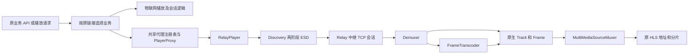

# Relay 软件架构

同一 wlw 进程中，路由依据配置的 vhost、app 及可选流名前缀，在流尚未注册时即可判断归属。Relay 自有协议逻辑位于 src/Relay。共享转码在 src/Codec，播放发布沿用 PlayerProxy 与 MultiMediaSourceMuxer。

播放器按发现、登录、等待轨道、播放和关闭推进。PlayerProxy 的重试创建新的 RelayPlayer，再次查询中继和凭据。异步回调使用弱引用，删除代理时先移出注册表再释放，迟到回调按对象所有权校验。协议响应、心跳和媒体包通过配套 protobuf-lite 源码解析。

转码请求按配置和输入编码、尺寸决定。视频显式缩放后进入共用编码器，音频复用解码、重采样及 AAC 编码。轨道交给 PlayerProxy 后再释放缓存帧，原 HLS 访问逻辑等待媒体注册和播放列表。等待者参与无人观看判定；重连后保留的 HLS cookie 可以重新取得新媒体源。旧 writer 的延迟清理按播放列表路径和 writer 身份检查。

[组件和源码位置](../relay/README.md) · [业务需求](business-requirements.md)
